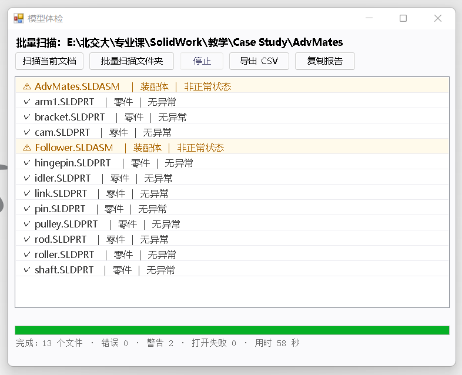

# 使用教程

> 适用于 SolidWorks 2025 · 版本 1.0



---

## 一、它解决什么问题

SolidWorks 自带的「什么错」对话框很好用，但它有个硬限制：一次只能看一个文件。

假设你有一个文件夹，里面躺着三十个零件和装配体。你想知道：

- 哪些模型有特征重建错误？
- 哪些装配体的零件链接断了（文件被移走或改名）？
- 哪些零件里有被压缩掉的零部件、多实体？

原生做法是：打开一个、点「什么错」、记下来、关掉、再开下一个。三十个文件就是三十遍。

**这个插件把这件事变成一个按钮，最后给你一张 CSV 表。**

---

## 二、安装

**系统要求**：Windows 10 / 11，SolidWorks 2025（版本 33.x），.NET Framework 4.8（Win10 1903 以上自带）。

下载 release 里的 zip，解压后应该看到：

```
SwAiGuide.dll                        插件本体
install.cmd  /  uninstall.cmd        安装 / 卸载
README.txt                           说明文件
使用教程.docx                         本文档
```

> 三个 `SolidWorks.Interop.*.dll` 必须与 `SwAiGuide.dll` 放在同一目录。
> 如果包里缺了它们，`install.cmd` 会自动从你本机的 SolidWorks 安装目录复制过去。

**安装步骤**：

1. **如果压缩包是从网上/微信传过来的**：先右键 zip → 属性 → 勾选「解除锁定」→ 确定，再解压
2. 完全关闭 SolidWorks（任务栏里也不能留）
3. 右键 `install.cmd` → 以管理员身份运行
4. 看到 `INSTALL OK` 后，启动 SolidWorks
5. 菜单栏：工具 → 插件 → 在列表里勾选 **Model Inspector**
6. 屏幕中央会弹出「模型体检」窗口

> ⚠️ 第 1 步是最容易漏的一步。漏了会报 `0x80131515` 或「未能加载文件或程序集」，
> 原因是 Windows 把下载来的 DLL 标记成了「来自网络」，.NET 出于安全直接拒绝加载。
> 解除锁定即可，不是文件坏了。

**卸载**：关闭 SolidWorks → 右键 `uninstall.cmd` → 以管理员身份运行。

---

## 三、界面速览

窗口从上到下分三块：

- **顶部标题行**：显示当前正在检查的文档名或文件夹路径
- **按钮行**：五个按钮，见下表
- **中间列表**：检查结果，按严重程度着色——红色是错误，橙色是警告，灰色是信息
- **底部**：进度条 + 状态行，显示「正在扫描 3/13」和最终统计

| 按钮 | 作用 | 使用时机 |
|---|---|---|
| 扫描当前文档 | 检查当前打开的那个文件 | 只想看手上这一个模型 |
| 批量扫描文件夹 | 递归检查一个目录下所有零件/装配体 | 交作业、交接文件、交付前自查 |
| 停止 | 中断批量扫描 | 文件太多、或者等不及了 |
| 导出 CSV | 把批量结果存成表格 | 需要留档、发给别人、用 Excel 排序 |
| 复制报告 | 把当前列表复制到剪贴板 | 要粘到聊天窗口或作业报告里 |

---

## 四、用法一：检查当前文档

1. 打开一个零件或装配体
2. 点「扫描当前文档」
3. 看列表：红色条目是需要处理的问题

单文档模式会输出更详细的信息，包括材料、实体数量这类参考项。

---

## 五、用法二：批量检查文件夹

1. 点「批量扫描文件夹」，选一个目录（会递归进子文件夹）
2. 等进度条走完。每扫完一个文件，列表里就会多一行 ✓ / ⚠ / ✖
3. 扫完后底部显示总计：多少个文件、多少错误、多少警告、用时多少秒
4. 需要留档就点「导出 CSV」

扫描过程中 SolidWorks 会逐个打开文件——这是必须的，因为特征信息只有打开后才读得到。
插件用的是静默 + 只读 + 轻化方式，不会弹窗、不会保存任何修改，扫完立刻关闭，
并且每关一个就自动把你的原文档切回前台。

---

## 六、怎么看结果

结果分三级：

- **✖ 错误** — 模型确实坏了，必须处理。比如特征重建失败、零件链接断了
- **⚠ 警告** — 模型能用，但状态不理想。比如零部件被压缩、零件是多实体
- **· 信息** — 只是统计数字，不是问题。比如特征总数、零部件数量

一个装配体的检查结果长这样（示例）：

```
✖ 特征重建异常：2/41 个：圆角2(2) 阵列1(1)
✖ 断链文件：3 个零部件的源文件找不到
⚠ 非正常状态：5 个零部件被压缩/轻化
· 零部件：86 个（唯一文件 41 种）
```

括号里的数字是 SolidWorks 的错误码，和「什么错」对话框里的一致。

---

## 七、导出 CSV

批量扫描完成后点「导出 CSV」，默认存到被扫描目录下，文件名带时间戳。

列含义：文件名称、类型、错误数、警告数、状态、主要问题、完整路径。
用 Excel 打开中文不会乱码（文件是 UTF-8 带 BOM）。

按「错误数」降序排一下，问题最多的文件立刻浮到最上面。

---

## 八、常见问题

**Q：插件列表里找不到 Model Inspector。**
A：多半是安装时 SolidWorks 没关干净。关掉后重新运行 `install.cmd`。

**Q：报 `0x80131515` 或「未能加载文件或程序集」。**
A：DLL 被标记为「来自网络」。右键属性解除锁定，或在该目录执行：`Get-ChildItem *.dll | Unblock-File`

**Q：扫描时 SolidWorks 窗口一直跳到前台。**
A：只要通过 SolidWorks 打开文件就会这样，是它的固有行为。
插件已经做到每扫完一个自动切回你的原文档。想彻底不打扰，目前没有好办法。

**Q：某些文件提示「文件不存在或路径无法访问」。**
A：文件其实在，但路径太长（超过 260 字符）或中文层级太深。把文件挪到更浅的目录再试。

**Q：扫描很慢。**
A：参考值——普通零件 3~4 秒/个，40+ 特征的复杂零件约 10 秒/个。
慢是因为必须真的打开文件。批量模式下装配体只检查顶层零部件，不往子装配体里钻。

**Q：扫描会不会改动我的文件？**
A：不会。以只读方式打开，关闭时丢弃所有改动，全程不写盘。

**Q：出问题了去哪看日志？**
A：`%LOCALAPPDATA%\SwAiGuide\addin.log`

---

## 九、已知限制

- 仅支持 SolidWorks 2025。其他版本不保证可用
- 批量模式不递归检查子装配体内部的特征错误
- 不做干涉检查（需要几何计算，会让速度掉一个数量级）
- 无法避免扫描时窗口跳前台
- 检查项目前偏「结构完整性」，不涉及设计规范、命名规范这类业务规则
